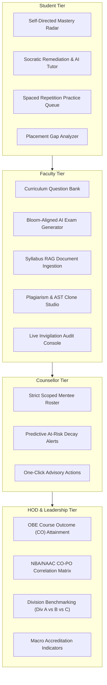
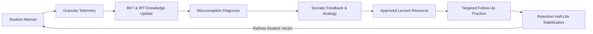
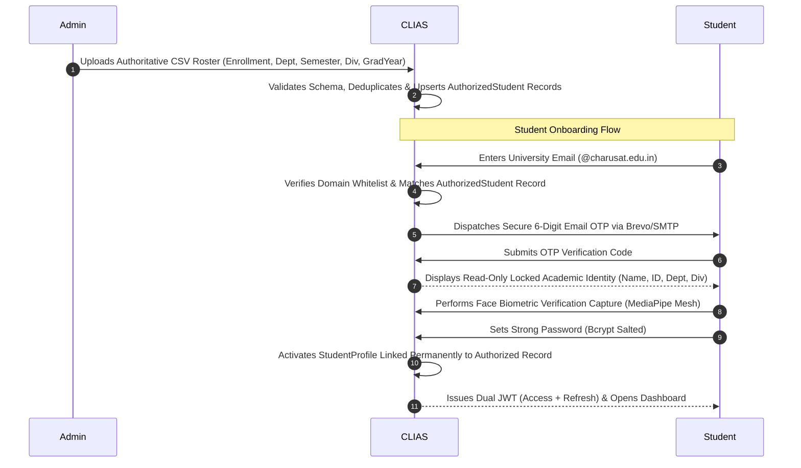

# CLIAS — Charotar Learning Intelligence & Assessment System

> **An enterprise AI-powered learning intelligence, adaptive practice, automated assessment, proctoring integrity, and mobile-synchronized examination ecosystem for university engineering education.**

[](#)
[-blue.svg)](#)
[-emerald.svg)](#)
[](#)
[-orange.svg)](#)
[](#)

---

## 📌 Institutional Heritage & Developers
- **Institution**: Charotar University of Science and Technology (CHARUSAT)
- **Faculty / Institute**: Chandubhai S. Patel Institute of Technology (CSPIT)
- **Department**: Department of Computer Science & Engineering (CSE)
- **Lead Engineers & Researchers**: **Jigar Sakhia** (`24CS090`) & **Param Shah** (`24CS093`)
- **Academic Year / Cohort**: B.Tech CSE Class of 2028 (Semester 5)

---

## Table of Contents

1. [Executive Summary & Core Value Proposition](#1-executive-summary--core-value-proposition)
2. [Multi-Tier Academic Intelligence Architecture](#2-multi-tier-academic-intelligence-architecture)
3. [Continuous Student Knowledge Modeling (The CLIAS Loop)](#3-continuous-student-knowledge-modeling-the-clias-loop)
4. [Technology Stack & Monorepo Ecosystem](#4-technology-stack--monorepo-ecosystem)
5. [Authoritative Registration, ID Matching & Biometric Onboarding](#5-authoritative-registration-id-matching--biometric-onboarding)
6. [Security Hardening, Neutralized Autofill & Dual-Storage API Rate Limiting](#6-security-hardening-neutralized-autofill--dual-storage-api-rate-limiting)
7. [Mobile-First Dual-View Institutional Data Tables (CARDIA Atlas)](#7-mobile-first-dual-view-institutional-data-tables-cardia-atlas)
8. [Phase 1–12 Complete Delivery Roadmap](#8-phase-112-complete-delivery-roadmap)
   - [Phase 1: Platform Foundation & Academic Hierarchy](#phase-1--platform-foundation--academic-hierarchy)
   - [Phase 2: Mathematical Learning Intelligence (EWMA, BKT, IRT, Ebbinghaus Decay, DAGs)](#phase-2--mathematical-learning-intelligence-ewma-bkt-irt-ebbinghaus-decay-dags)
   - [Phase 3: AI Socratic Learning Assistant & Distractor Diagnostics](#phase-3--ai-socratic-learning-assistant--distractor-diagnostics)
   - [Phase 4: Misconception Detection & Dynamic Difficulty Calibration](#phase-4--misconception-detection--dynamic-difficulty-calibration)
   - [Phase 5: Faculty Exam Orchestrator & Timed Evaluation Engine](#phase-5--faculty-exam-orchestrator--timed-evaluation-engine)
   - [Phase 6: Bloom's Taxonomy AI Assessment Generator (Human-in-the-Loop)](#phase-6--blooms-taxonomy-ai-assessment-generator-human-in-the-loop)
   - [Phase 7: Syllabus-Grounded Document AI / RAG Question Extractor](#phase-7--syllabus-grounded-document-ai--rag-question-extractor)
   - [Phase 8: University Analytics, OBE Attainment & NBA/NAAC CO-PO Matrix](#phase-8--university-analytics-obe-attainment--nbanaac-co-po-matrix)
   - [Phase 9: AI-Assisted Proctoring Integrity & Real-Time Telemetry](#phase-9--ai-assisted-proctoring-integrity--real-time-telemetry)
   - [Phase 10: Career Placement Readiness & Industry Skill Gap Matrix](#phase-10--career-placement-readiness--industry-skill-gap-matrix)
   - [Phase 11: In-Browser Coding Arena & Sandboxed Execution Judge](#phase-11--in-browser-coding-arena--sandboxed-execution-judge)
   - [Phase 12: Code Plagiarism Detection & Structural AST Similarity Engine](#phase-12--code-plagiarism-detection--structural-ast-similarity-engine)
9. [Mobile Answer Companion & Live Multi-Device Exam Synchronization](#9-mobile-answer-companion--live-multi-device-exam-synchronization)
10. [Database Entity Architecture (Prisma & MySQL)](#10-database-entity-architecture-prisma--mysql)
11. [Environment Configuration & Variables Reference](#11-environment-configuration--variables-reference)
12. [Local Setup & Development Guide](#12-local-setup--development-guide)
13. [Pre-Seeded Roster & Development Credentials](#13-pre-seeded-roster--development-credentials)
14. [Recommended Technical Demonstration Walkthrough](#14-recommended-technical-demonstration-walkthrough)

---

## 1. Executive Summary & Core Value Proposition

Traditional university software ecosystems suffer from a structural divide:
- **Learning Management Systems (LMS)** function primarily as passive PDF repositories and static grade sheets.
- **Online Quiz Portals** record isolated pass/fail marks, completely oblivious to cognitive learning curves, conceptual decay, or deep misconceptions.
- **Examination Software** operates in silos without informing downstream remedial instruction.

A student scoring 14 out of 20 on an assessment leaves faculty blind to whether the student guessed easy questions, mastered complex algorithmic concepts, struggled with recursion, or will forget the concept within three weeks.

**CLIAS** (Charotar Learning Intelligence & Assessment System) reimagines university learning as a continuous, closed-loop intelligence system. Rather than reducing a student's semester to a static GPA, CLIAS continuously tracks:
- **Granular Interaction Telemetry**: Sub-second question timers, hint usage, distractor selection patterns, and attempt frequencies.
- **Continuous Knowledge Modeling**: Live Bayesian Knowledge Tracing (BKT) and Item Response Theory (IRT) estimating latent ability ($\theta$).
- **Conceptual Pitfall Detection**: Automatic identification of root misconceptions through distractor classification.
- **Knowledge Retention Curves**: Ebbinghaus forgetting curves with dynamic half-life stability modeling to trigger spaced repetition before decay occurs.
- **Pedagogical Dependency Navigation**: Directed Acyclic Graph (DAG) validation ensuring prerequisite mastery before advancing to downstream topics.

---

## 2. Multi-Tier Academic Intelligence Architecture

CLIAS synthesizes practice, test, and behavioral telemetry into actionable intelligence customized across five distinct institutional tiers:

```
Student ──► Faculty ──► Counsellor ──► HOD ──► Institutional Head / Provost
```



---

## 3. Continuous Student Knowledge Modeling (The CLIAS Loop)

The foundational principle of CLIAS is the **Continuous Learning Loop**, transforming every incorrect answer into a diagnostic trigger:



---

## 4. Technology Stack & Monorepo Ecosystem

CLIAS is architected as an enterprise monorepo combining modern web, high-performance API, specialized AI microservices, and mobile synchronization:

```
clias/
├── apps/
│   ├── api/          # NestJS 10 API Gateway (TypeScript, Prisma ORM, Redis, JWT, RBAC)
│   ├── web/          # Next.js 14 App Router (React 18, Tailwind CSS, Recharts, CARDIA Atlas)
│   ├── ai/           # FastAPI Microservice (Python 3.11, RAG, AST Winnowing, Socratic Agents)
│   └── mobile/       # Flutter Mobile Companion (Dart, Camera, Digital Ink, WebRTC Sync)
└── packages/         # Shared TypeScript configuration, DTOs, and utility interfaces
```

| Layer | Technology | Version | Purpose in CLIAS |
|---|---|---|---|
| **Web Portal** | Next.js (App Router) | 14.2+ | High-performance institutional web portal with dual-view mobile responsiveness |
| **Language** | TypeScript | 5.3+ | End-to-end type safety across client, server, and shared contracts |
| **Styling & System** | Tailwind CSS | 3.4+ | CARDIA Atlas architectural design system, monospace styling, touch ergonomics |
| **Visualization** | Recharts | 2.12+ | Dynamic Bayesian learning curves, forgetting rate decay lines, skill radars |
| **Core API Gateway** | NestJS | 10.3+ | Modular backend architecture, dependency injection, route guards, throttlers |
| **Relational ORM** | Prisma ORM | 5.10+ | Declarative migrations, schema synchronization, type-safe queries |
| **Database** | MySQL / MariaDB | 8.0+ | Strongly normalized relational schema with ACID integrity |
| **Distributed Caching** | Upstash Redis | REST API | Multi-region distributed rate-limiting and session store with in-memory fallback |
| **AI Microservice** | FastAPI & Python | Python 3.11+ | Document RAG chunking, AST structural similarity, and Socratic LLM agents |
| **Mobile Companion** | Flutter / Dart | Flutter 3.19+ | Mobile handwritten answer digitizer and synchronized examination camera |

---

## 5. Authoritative Registration, ID Matching & Biometric Onboarding

### Zero Self-Declaration Principle
In real-world university environments, self-declared student registrations lead to enrollment tampering, invalid division assignments, and fraudulent profiles. CLIAS enforces **Authoritative Academic Roster Anchoring**:



- **Seeded Cohort**: Pre-seeded with institutional students including **Jigar Sakhia** (`24CS090`) and **Param Shah** (`24CS093`), CSPIT CSE, Semester 5, Division 2, Class of 2028.
- **Email Service**: Dual driver supporting **Brevo API (HTTPS port 443)** for serverless/cloud environments where SMTP ports are blocked, with full SMTP fallback.

---

## 6. Security Hardening, Neutralized Autofill & Dual-Storage API Rate Limiting

### 1. Neutralized Browser Autofill & Clean Login
- Login and registration forms enforce `autoComplete="off"` with initial empty state bindings and institutional placeholders.
- Eliminates browser credential leakage, preventing auto-filling administrative credentials when students use shared campus workstations.

### 2. Dual-Storage Distributed API Rate Limiter
To defend critical authentication and OTP routes against credential stuffing, brute-force password guessing, and SMS/Email flooding, CLIAS features a production-grade rate limiting architecture:

- **Upstash Redis + In-Memory Fallback**:
  - Automatically connects to **Upstash Redis** REST API (`UPSTASH_REDIS_REST_URL`, `UPSTASH_REDIS_REST_TOKEN`) when configured.
  - **Zero-Crash Resilience**: If Redis credentials are not supplied (local offline dev, unit tests, CI), the engine automatically falls back to an in-memory sliding-window store without throwing an error.
- **Route-Specific Security Policies**:

| Endpoint | Method | Rate Limit Window | Max Attempts | Defense Target |
|---|:---:|:---:|:---:|---|
| `/auth/login` | `POST` | 60 seconds | **5 attempts** | Brute-force password guessing |
| `/auth/register/request-otp` | `POST` | 300 seconds (5 min) | **3 requests** | Email spamming & OTP flooding |
| `/auth/register/verify-otp` | `POST` | 300 seconds (5 min) | **5 attempts** | 6-digit OTP brute-force enumeration |
| `/auth/register` | `POST` | 60 seconds | **5 submissions** | Sybil account creation spam |
| `/auth/courses`, `/auth/me` | `GET` | 60 seconds | **60 requests** | Normal authenticated read operations |

- **Cloud Reverse Proxy Support**: Resolves genuine client IPs by inspecting `x-forwarded-for` and `cf-connecting-ip` with fallback to `req.ip`.
- **Institutional HTTP 429 Response**:
  ```json
  {
    "statusCode": 429,
    "error": "Too Many Requests",
    "message": "Too many attempts. For security, please wait a moment before trying again.",
    "retryAfter": 45
  }
  ```
- **Standard Security Headers**: Returns `Retry-After: 45`, `X-RateLimit-Limit`, and `X-RateLimit-Remaining`.
- **Frontend Cooldown Safeguard**: `apps/web` catches 429 responses, renders a real-time countdown timer, and automatically disables submit buttons until the cooldown period expires.

---

## 7. Mobile-First Dual-View Institutional Data Tables (CARDIA Atlas)

Standard analytical dashboards break on mobile viewports (< 768px), causing unreadable horizontal scrollbars. CLIAS implements a **Dual-View Component Architecture**:

```
Desktop (≥ 768px): Dense Institutional Tabular View (hidden md:block)
Mobile (< 768px): Touch-Friendly CARDIA Atlas Card Layout (md:hidden)
```

### Optimized Mobile Tables:
1. **Homepage Knowledge Gaps Matrix (`/`)**:
   - Desktop: 4-column data table (Topic, Concept %, Application %, Problem Solving %).
   - Mobile: Interactive card per topic with active triage badge and a 3-column heatmap metric grid preserving diagnostic color-coding.
2. **Faculty Topic Mastery & Struggle Heatmap (`/faculty/analytics`)**:
   - Desktop: 6-column analytical table (Curriculum Topic, Mastery, Attempts, Struggle Rate, Status, Diagnostic).
   - Mobile: High-contrast metric cards with animated mastery progress bars and a **44px touch-accessible collapsible disclosure** for reading full pedagogical misconception diagnostics without horizontal scrolling.
3. **Counsellor Mentee Tracking Table (`/faculty/counselling/students`)**:
   - Desktop: 7-column student monitoring table.
   - Mobile: Student card featuring avatar initial, enrollment tag, BKT score bar, proctoring trust badge, and full-width tap targets for "Inspect Student" and "Add Advisory".
4. **Super Admin Student Roster (`/admin/students`)**:
   - Desktop: Dense institutional table of authorized enrollments.
   - Mobile: Responsive card list highlighting student division, academic program, and activation state.

---

## 8. Phase 1–12 Complete Delivery Roadmap

All twelve development phases are fully implemented, verified, and operational:

```
[Phase 1: Foundation] ──► [Phase 2: Intelligence] ──► [Phase 3: Socratic AI] ──► [Phase 4: Adaptive]
          │                        │                         │                        │
[Phase 5: Assessment] ──► [Phase 6: Question Gen] ──► [Phase 7: Document RAG] ──► [Phase 8: Analytics]
          │                        │                         │                        │
[Phase 9: Proctoring] ──► [Phase 10: Placement]   ──► [Phase 11: Coding Judge]──► [Phase 12: Plagiarism]
```

### Phase 1: Platform Foundation & Academic Hierarchy
- Full relational hierarchy: Institute $\to$ Department $\to$ Program $\to$ Course $\to$ Topic.
- Super Admin CSV upload with parsing diagnostics and batch upsert.
- Question bank MVP with difficulty scaling (`EASY`, `MEDIUM`, `HARD`) and zero-leakage server-side answer evaluation.

### Phase 2: Mathematical Learning Intelligence
- **Bayesian Knowledge Tracing (BKT)**: Dedicated probabilistic model tracking latent knowledge state $P(L_t)$ with canonical parameters ($P(L_0)=0.20, P(T)=0.15, P(G)=0.20, P(S)=0.10$).
- **Item Response Theory (IRT)**: 2PL logistic response model calculating student latent ability ($\theta \in [-3.0, +3.0]$) and percentile ranking.
- **Ebbinghaus Forgetting Curves**: Memory half-life stability calculation $S$, retention rate $R(t) = e^{-t/S}$, and decay-adjusted mastery scores.
- **Curriculum Prerequisite DAGs**: Directed Acyclic Graphs enforcing pedagogical topic sequencing (e.g., Arrays $\to$ Linked Lists $\to$ Trees $\to$ Dynamic Programming).

### Phase 3: AI Socratic Learning Assistant & Distractor Diagnostics
- Multi-turn interactive Socratic guidance (`Explain More Simply`, `Show Real-World Example`, `Ask Follow-Up`, `Practice Similar`).
- Distractor diagnosis analyzing why a chosen incorrect option reveals conceptual deficiencies.
- Direct linkage to verified university lecture slides and faculty video resources.

### Phase 4: Misconception Detection & Dynamic Difficulty Calibration
- Distractor taxonomy identifying recurring error patterns (e.g., linear scan assumptions in binary search).
- Real-time adaptive difficulty engine adjusting practice difficulty based on live performance vectors.
- Spaced repetition queue automatically scheduling reviews at 7, 21, and 45-day intervals.

### Phase 5: Faculty Exam Orchestrator & Timed Evaluation Engine
- Faculty examination creator with customizable time windows, durations, passing marks, and question shuffling.
- Timed examination console with auto-save telemetry and instant server-side grading upon submission.

### Phase 6: Bloom's Taxonomy AI Assessment Generator (Human-in-the-Loop)
- AI Question Studio generating questions mapped to Bloom's taxonomy (`REMEMBER`, `UNDERSTAND`, `APPLY`, `ANALYZE`, `EVALUATE`, `CREATE`).
- **Strict Human-in-the-Loop Quality Gate**: AI-generated questions staged in review status, requiring explicit faculty verification before publishing.

### Phase 7: Syllabus-Grounded Document AI / RAG Question Extractor
- Ingestion of course syllabi, lecture presentations, and reference PDFs with structural token chunking.
- Hybrid lexical and semantic vector retrieval with confidence scoring.
- Grounded quiz synthesis with direct source citations from uploaded documents.

### Phase 8: University Analytics, OBE Attainment & NBA/NAAC CO-PO Matrix
- Direct Course Outcome (CO1..CO5) attainment calculations from student examination attempts.
- Program Outcome (PO1..PO12) correlation matrix aligned with NBA Criteria 3 & 4.
- Counsellor At-Risk early warning queue with one-click advisory intervention tracking.
- Inter-division benchmarking (Division A vs. Division B vs. Division C).

### Phase 9: AI-Assisted Proctoring Integrity & Real-Time Telemetry
- Client-side face detection and liveness monitoring during examinations.
- Real-time behavioral event logging: `TAB_SWITCH`, `WINDOW_BLUR`, `FULLSCREEN_EXIT`, `NO_FACE`, `MULTIPLE_FACES`.
- Dynamic Trust Score calibration (deductions based on severity, auto-flagging at $< 65\%$).
- Invigilator Audit Console with chronological event replay and official faculty determination (`CLEARED`, `FLAGGED`, `PENALIZED`).

### Phase 10: Career Placement Readiness & Industry Skill Gap Matrix
- Calibrated skill benchmarks for industry roles: Software Development Engineer (SDE), Data Analyst, Machine Learning Engineer, and GATE CS.
- Live skill gap radar highlighting student strengths against hiring benchmarks.
- Automated 4-week remedial bridge curriculum linking skill gaps to targeted algorithm drills.

### Phase 11: In-Browser Coding Arena & Sandboxed Execution Judge
- In-browser multi-language code editor supporting Python 3.11, JavaScript (Node.js 20), C++20, and Java 21.
- Sub-millisecond sandboxed code execution against hidden and sample test cases.
- Runtime profiling, memory consumption telemetry, and itemized test verdict inspector.

### Phase 12: Code Plagiarism Detection & Structural AST Similarity Engine
- Language-agnostic Abstract Syntax Tree (AST) tokenization stripping comments, formatting, and variable renaming.
- Winnowing fingerprinting algorithm with k-gram hashing (`POST /api/v1/ai/plagiarism/compare-ast`).
- Faculty audit console with pairwise Jaccard index similarity sliders and side-by-side synchronized code diff inspector.

---

## 9. Mobile Answer Companion & Live Multi-Device Exam Synchronization

CLIAS bridges paper-based university exams with digital evaluation through the **CLIAS Answer Companion** (`apps/mobile`):
- **Handwritten Solution Digitization**: Students capture complex mathematical derivations and handwritten algorithm trace tables using the mobile camera.
- **WebSocket / WebRTC Live Pairing**: Instant QR-code handshake pairs the desktop exam console with the mobile companion.
- **Real-Time Canvas Sync**: Uploaded images are synchronized directly into the student's active exam submission canvas for faculty review.

---

## 10. Database Entity Architecture (Prisma & MySQL)

The relational schema is strongly normalized with full referential integrity:

| Entity | Primary Key | Role & Key Relations |
|---|:---:|---|
| `User` | UUID | Core authentication entity (email, passwordHash, role, status, emailVerified) |
| `Institute` | UUID | University institute entity (e.g., CSPIT, DEPSTAR) |
| `Department` | UUID | Department entity (e.g., CSE, IT) linked to parent Institute |
| `Program` | UUID | Degree program (e.g., BTECH_CSE) linked to Department |
| `Course` | UUID | Academic subject (e.g., CS301 DSA) with semester and department linkage |
| `Topic` | UUID | Syllabus concept with recursive `parentTopicId` for subtopic trees |
| `AuthorizedStudent` | UUID | Authoritative roster entity imported via CSV (Enrollment, Dept, Semester, Div) |
| `StudentProfile` | UUID | Operational student record linking authenticated `User` to `AuthorizedStudent` |
| `FacultyProfile` | UUID | Faculty entity storing employee code and department assignment |
| `Question` | UUID | Assessment item with difficulty, Bloom level, explanation, and sourceType |
| `QuestionOption` | UUID | Multiple-choice options with `isCorrect` flag and display order |
| `PracticeSession` | UUID | Interactive practice session tracking duration and question counts |
| `QuestionAttempt` | UUID | Granular attempt log storing chosen option, timeTakenSeconds, and correctness |
| `SkillMastery` | UUID | Live topic mastery score (0-100), BKT probability, and IRT theta |
| `LearningHistory` | UUID | Immutable chronological snapshot of mastery transitions |
| `CounsellorAssignment`| UUID | Strict mapping table assigning specific student profiles to counsellor users |
| `CourseDocument` | UUID | Course syllabi and reference lecture presentations for RAG ingestion |
| `DocumentChunk` | UUID | Structural chunks with token count, page number, and semantic tags |
| `ProgramOutcome` | UUID | Institutional engineering graduate attributes (PO1..PO12) for NBA accreditation |
| `CourseOutcome` | UUID | Course competencies (CO1..CO5) with direct attainment tracking |
| `ProctoringSession` | UUID | Live exam proctoring state, face verification, and dynamic trust score |
| `ProctoringViolation`| UUID | Infraction audit log (tab switch, window blur, multiple faces, camera drop) |
| `CareerRoleBenchmark`| UUID | Industry standards (SDE, Data Analyst) with target skill masteries |
| `CodingProblem` | UUID | Algorithmic problem with constraints, hints, and starter templates |
| `TestCase` | UUID | Automated test cases (sample & hidden benchmark) with limits |
| `CodeSubmission` | UUID | Sandboxed submission records with execution runtime and memory metrics |
| `PlagiarismScan` | UUID | Plagiarism scan jobs with candidate counts and similarity threshold |
| `PlagiarismMatch` | UUID | Flagged pairwise clones with similarity score, AST token ranges, and verdict |

---

## 11. Environment Configuration & Variables Reference

### Backend API Configuration (`apps/api/.env`)
```env
# ==============================================================================
# 1. Institutional Branding & Domain Validation
# ==============================================================================
UNIVERSITY_NAME=CHARUSAT
UNIVERSITY_FULL_NAME="Charotar University of Science and Technology"
UNIVERSITY_EMAIL_DOMAIN=charusat.edu.in
UNIVERSITY_PORTAL_TITLE="CLIAS — Learning Intelligence & Assessment Platform"

# ==============================================================================
# 2. Server & Routing
# ==============================================================================
NODE_ENV=development
PORT=4000
API_PORT=4000
API_PREFIX=api/v1
API_URL=http://localhost:4000/api/v1

# ==============================================================================
# 3. Database Connection (MySQL / MariaDB via Prisma)
# ==============================================================================
DATABASE_URL="mysql://root:@localhost:3306/clias_db"

# ==============================================================================
# 4. Security & JWT Authentication
# ==============================================================================
JWT_SECRET=clias_super_secure_jwt_secret_development_key_change_in_prod_987654321
JWT_EXPIRES_IN=7d
JWT_REFRESH_SECRET=clias_super_secure_refresh_secret_development_key_change_in_prod_12345
JWT_REFRESH_EXPIRES_IN=30d

# ==============================================================================
# 5. Email Service & OTP Delivery (Brevo / SMTP / Development)
# ==============================================================================
EMAIL_SERVICE_DRIVER=brevo
BREVO_API_KEY=your_brevo_api_key_here
BREVO_SENDER_NAME="CLIAS CHARUSAT"
BREVO_SENDER_EMAIL=your_email@charusat.edu.in
EMAIL_FROM="no-reply@charusat.edu.in"

# ==============================================================================
# 6. AI Microservice Bridge
# ==============================================================================
AI_SERVICE_URL=http://localhost:8000

# ==============================================================================
# 7. Distributed Rate Limiting (Upstash Redis with In-Memory Fallback)
# Optional: Omit or leave blank to automatically use in-memory sliding window
# ==============================================================================
UPSTASH_REDIS_REST_URL=https://your-database.upstash.io
UPSTASH_REDIS_REST_TOKEN=your_upstash_token_here
```

### Frontend Web Configuration (`apps/web/.env.local`)
```env
NEXT_PUBLIC_API_URL=http://localhost:4000/api/v1
NEXT_PUBLIC_UNIVERSITY_NAME=CHARUSAT
NEXT_PUBLIC_UNIVERSITY_EMAIL_DOMAIN=charusat.edu.in
NEXT_PUBLIC_PORTAL_TITLE="CLIAS — University Learning Intelligence"
```

---

## 12. Local Setup & Development Guide

### Prerequisites
- **Node.js**: v18+ (tested on Node v20 / v24)
- **npm**: v10+
- **MySQL**: 8.0+ / MariaDB (e.g. XAMPP, native MySQL, or Docker)
- **Python**: 3.10+ (for AI microservice)
- **Flutter SDK**: 3.19+ (optional, for mobile answer companion)

---

### Step 1: Database Initialization
Ensure MySQL is active on `localhost:3306` (or `3307`). Create the database:
```sql
CREATE DATABASE IF NOT EXISTS clias_db CHARACTER SET utf8mb4 COLLATE utf8mb4_unicode_ci;
```

---

### Step 2: Backend API Setup (`apps/api`)
```bash
cd apps/api
npm install
npx prisma generate
npx prisma db push
npm run db:seed
npm run dev
```
*API Gateway active at `http://localhost:4000/api/v1`.*

---

### Step 3: Frontend Web Setup (`apps/web`)
```bash
cd apps/web
npm install
npm run dev
```
*Web Portal accessible at `http://localhost:3000`.*

---

### Step 4: AI Microservice Setup (`apps/ai`)
```bash
cd apps/ai
pip install -r requirements.txt
python main.py
```
*FastAPI microservice active at `http://localhost:8000/health`.*

---

### Step 5: Verification & Type Checks
```bash
# Verify backend build
cd apps/api && npm run build

# Verify frontend types
cd apps/web && npx tsc --noEmit
```

---

## 13. Pre-Seeded Roster & Development Credentials

All pre-seeded institutional demo accounts use the standard password: **`clias123`**

| Role | University Email | Institutional Persona & Scope |
|---|---|---|
| **STUDENT** | `student@charusat.edu.in` | Rahul Patel (24CS001, CSPIT CSE, Sem 5). Active dashboard with real learning curves, practice logs, and placement gap radar. |
| **FACULTY** | `faculty@charusat.edu.in` | Dr. CSE Faculty. Assigned to CS301 (Data Structures). Full access to Question Bank, Exam Studio, Invigilation, and Plagiarism Studio. |
| **COUNSELLOR** | `counsellor@charusat.edu.in` | Academic Mentor. Scoped view showing only assigned mentees via `CounsellorAssignment` records. |
| **HOD** | `hod@charusat.edu.in` | Head of Department. Department-level aggregate curriculum health, division comparisons, and NBA CO-PO attainment matrices. |
| **SUPER_ADMIN** | `admin@charusat.edu.in` | University System Administrator. Roster management, student activations, and authorized student CSV import. |

### Pre-Seeded Authorized Student Records:
- **Jigar Sakhia** (`24CS090`) — Department of Computer Science & Engineering, CSPIT, Semester 5, Division 2, Class of 2028.
- **Param Shah** (`24CS093`) — Department of Computer Science & Engineering, CSPIT, Semester 5, Division 2, Class of 2028.

---

## 14. Recommended Technical Demonstration Walkthrough

For evaluations, academic committee reviews, and viva presentations:

1. **Roster Management & Institutional Verification**:
   - Log in as **Super Admin** (`admin@charusat.edu.in` / `clias123`).
   - Open **Authorized Students** (`/admin/students`) to show the pre-approved institutional roster and CSV import diagnostics.
2. **Student Registration with ID Matching & Biometric Onboarding**:
   - Open `/auth/register`. Enter `24cs090@charusat.edu.in`.
   - Observe real-time student ID match, 6-digit OTP verification, read-only locked academic details, and face biometric enrollment.
3. **API Rate Limiting & Autofill Neutralization**:
   - Open `/auth/login`. Notice the clean form with no browser credential autofill.
   - Intentionally trigger 5 failed logins within 60 seconds.
   - Observe the `HTTP 429 Too Many Requests` response, standard `Retry-After` header, client toast alert, and automatic button cooldown timer.
4. **Mobile-Responsive Dual-View Institutional Tables**:
   - Toggle browser DevTools to mobile viewport (< 768px).
   - Show how wide data tables on `/` (Knowledge Gaps), `/faculty/analytics` (Mastery Heatmap), and `/faculty/counselling/students` (Mentee Tracker) transform smoothly into CARDIA Atlas cards with collapsible disclosures and 44px touch targets without horizontal page overflow.
5. **Student Learning Intelligence & Socratic Assistant**:
   - Log in as **Student** (`student@charusat.edu.in` / `clias123`).
   - Demonstrate the dynamic Recharts learning curve, Bayesian Knowledge Tracing scores, and Ebbinghaus forgetting decay indicators.
   - Run a practice session in **CS301 (Data Structures)**. Select an intentional distractor to trigger the Socratic assistant, distractor breakdown, and lecture slide recommendation.
6. **Faculty Exam Creation & Syllabus Document RAG**:
   - Log in as **Faculty** (`faculty@charusat.edu.in` / `clias123`).
   - In **Exam Studio**, generate Bloom-taxonomy aligned questions using AI, review candidate items, and stage them directly into the course exam.
   - Demonstrate the syllabus document RAG question extractor with cited references.
7. **Exam Invigilation & Code Plagiarism Detection**:
   - Start an assessment as a student and simulate tab switching or face disappearance.
   - Open `/faculty/invigilation` to show real-time violation telemetry and dynamic trust score deduction.
   - Open `/faculty/plagiarism` to demonstrate the AST winnowing structural clone detector with side-by-side synchronized code comparison.
8. **Institutional Outcome-Based Education (OBE) Analytics**:
   - Log in as **HOD** (`hod@charusat.edu.in` / `clias123`).
   - Inspect direct Course Outcome (CO1..CO5) attainment levels, NBA PO correlation matrices, and division-to-division comparative benchmarks.

---

*CLIAS — Engineered for Academic Excellence at Charotar University of Science and Technology (CHARUSAT).*  
*Developed by Jigar Sakhia & Param Shah.*
